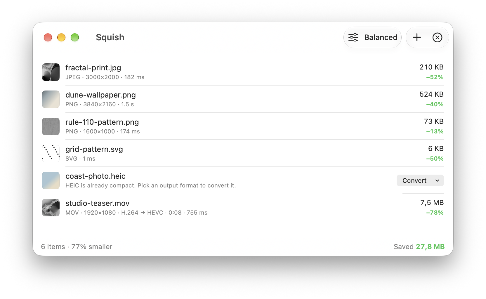

# Squish

A native macOS image and video optimizer: a SwiftUI (Liquid Glass) app on top of a Rust image engine
and Apple's hardware video encoder.

**[Download for Mac](https://github.com/vunguyentuan/squish/releases/latest/download/Squish.dmg)** (macOS 26+, Apple Silicon, notarized) · **[Website](https://squish.madebyvu.com)**



## Build from source

```
make run       # build the Rust engine + app → build/Squish.app, then launch
make install   # copy to /Applications (enables Finder Services + Launch at Login)
make test      # engine (cargo) and app (Swift Testing) tests
make release   # Developer ID sign + notarize → build/Squish.dmg (needs your own certificate and `npm i -g create-dmg`)
make publish   # GitHub release + deploy the site and Sparkle appcast (notes from release-notes/<version>.md)
```

Requires macOS 26+, Xcode 26+, Rust (Homebrew or rustup).

## Engine (`core/`, Rust → `libsquish_core.a`, C ABI in `core/include/squish_core.h`)

| Format | Lossy | Lossless |
|---|---|---|
| PNG | libimagequant palette quantization → oxipng | oxipng (Zopfli at *Maximum*), APNG-safe |
| JPEG | mozjpeg trellis re-encode, *and* lossless transcode — smaller wins | jpegtran-style DCT transcode + progressive scan search (pixel-identical) |
| WebP | libwebp method 6, sharp YUV | VP8L re-encode for lossless sources |
| SVG | OXVG (Rust port of SVGO) | — |
| → WebP / AVIF / JPEG | conversion from PNG, JPEG, TIFF, BMP, GIF, HEIC*, AVIF* | |
| Animated GIF → WebP | libwebp WebPAnimEncoder, per-frame lossy/lossless mix | lossless WebP frames |
| Resize | fast_image_resize (Lanczos3, SIMD, alpha-aware) to a maximum edge, in any of the above | |

\* HEIC/AVIF are decoded by ImageIO in the app and handed to the engine as PNG.

Rules: a file is never made bigger (the original is left untouched), photo orientation
survives metadata stripping, ICC profiles are kept by default. Resizing and conversion always
write a file, because that's what was asked for.

## Command line (`squish`)

The app binary doubles as a CLI when it's run as `squish` (*Settings → Automation → Install
Command-Line Tool* links it into `/usr/local/bin`). The same
code builds standalone with `cargo build --release --manifest-path core/Cargo.toml` →
`core/target/release/squish`.

```
squish photo.jpg                     # → photo-squished.jpg
squish -i -r 2560 assets/            # in place, recursively, downscaled to 2560 px
squish -f webp -q 75 *.png           # convert
squish -n --json shots/ | jq …       # dry run, one JSON object per file
```

Images only (PNG, JPEG, WebP, SVG, GIF, TIFF, BMP): HEIC/AVIF decoding and video live in the app.
Exit code 1 if any file failed, 2 for usage errors.

## Video (`App/Sources/Squish/Engine/VideoWork.swift`, AVFoundation)

MOV, MP4 and M4V are re-encoded to HEVC (`hvc1`) with VideoToolbox at constant quality, in the
same container. Resolution, frame rate, rotation and colour are kept; HDR (HLG/PQ) stays 10-bit.
AAC audio is copied, other mono/stereo audio becomes AAC, surround is copied as is. Output is
fast-start (index first) for the web. A video is only replaced if it shrinks by at least 10%, and
Squish tags its own output ("encoding software: Squish") so dropping it again doesn't re-encode it.
Lossless mode skips videos. Videos encode one at a time (they share the hardware encoder);
Fast/Balanced effort lets the encoder prioritize speed (~1.75× faster, ~6% larger), Maximum doesn't.
*Resize to fit* scales videos down too.

Animated GIFs can become H.264 MP4 (`App/Sources/Squish/Engine/GIFVideo.swift`): ImageIO frames
with their own delays, drawn over white on an even-sized canvas, so they play anywhere.

## App (`App/`, SwiftPM)

- **Drop anywhere** in the window, on the Dock icon, via *Open With*, Finder *Services → Optimize with Squish*, or ⌘O.
- **Shake to Drop**: shake the cursor while dragging files in any app; a glass shelf appears
  under the cursor. Drop, watch it squish, then drag the optimized files straight back out.
  Works with no Accessibility permission (mouse-down monitor + cursor sampling + drag pasteboard).
- **Safe replace**: originals are cloned (free on APFS) into the Trash; *Restore* puts them back.
  Finder tags, creation date and permissions are preserved.
- Space for **Quick Look**, before/after **compare slider** (images), inline **Convert** for HEIC/TIFF/GIF, presets (Lossless / Balanced / Smallest),
  menu bar extra, `squish://shelf`, `squish://clipboard` and `squish://open` URLs, Launch at Login.
- **Resize to fit**: an optional maximum edge (e.g. 2560 px) for images and videos.
- **Per-format rules** (*Settings → Formats*): e.g. PNG lossless, HEIC → JPEG, animated GIF → MP4.
- **Watched folders** (*Settings → Automation*): new files saved there are optimized automatically —
  one click adds the Screenshots folder. Squish tags what it writes (`dev.squish.optimized` xattr),
  so its own output never triggers another pass.
- **Clipboard**: ⌃⌥⌘V optimizes the copied image in place (PNG stays PNG, so it pastes anywhere);
  a global hotkey via Carbon, no Accessibility permission.
- **Shortcuts**: *Optimize Files* (preset, format, resize, save mode; returns the files) and
  *Optimize Clipboard Image*. SwiftPM doesn't produce App Intents metadata, so `build-app.sh` has
  the compiler emit const values and runs `appintentsmetadataprocessor` itself.
- **Reports**: *Copy Summary* (⇧⌘C) and *Export Report…* (⌘E, CSV); all-time savings in the menu bar and About.
- Localized into English, Vietnamese, Spanish, French, German, Japanese and Simplified Chinese
  (`App/Resources/Localizable.xcstrings`, compiled by `xcstringstool` at build time).

## Layout

```
core/src/      lib.rs (FFI) · engine.rs (dispatch) · png_opt · jpeg · webp_opt · avif · svg · anim · resize · decode · exif · format · cli
App/Sources/   Engine/ (Swift bridge, video, GIF→MP4) · Model/ (queue, file ops, prefs, watcher, stats) · Clipboard/ · Intents/ · Shake/ · Views/
App/Tests/     Swift Testing: file placement, backups/restore, format rules, conversions
App/Resources/ Info.plist · Localizable.xcstrings
scripts/       build-app.sh (bundle + ad-hoc sign) · release.sh (DMG + notarize + cask) · make-icon.swift (renders the icon)
packaging/     Homebrew cask template (release.sh fills in version and sha256)
site/          landing page
```

To update localizations after changing UI text: build with
`-Xswiftc -emit-localized-strings -Xswiftc -emit-localized-strings-path -Xswiftc <dir>`, then
`xcrun xcstringstool sync App/Resources/Localizable.xcstrings --stringsdata <dir>/*.stringsdata`
(or open the catalog in Xcode).

The landing page lives in `site/` (Cloudflare Workers static assets: `cd site && wrangler deploy`).

## License

Squish is free software under the [GNU GPL v3.0](LICENSE). It links libimagequant (GPL-3.0),
mozjpeg (IJG/BSD), libwebp (BSD), rav1e (BSD-2-Clause), oxipng (MIT) and OXVG (MIT).
